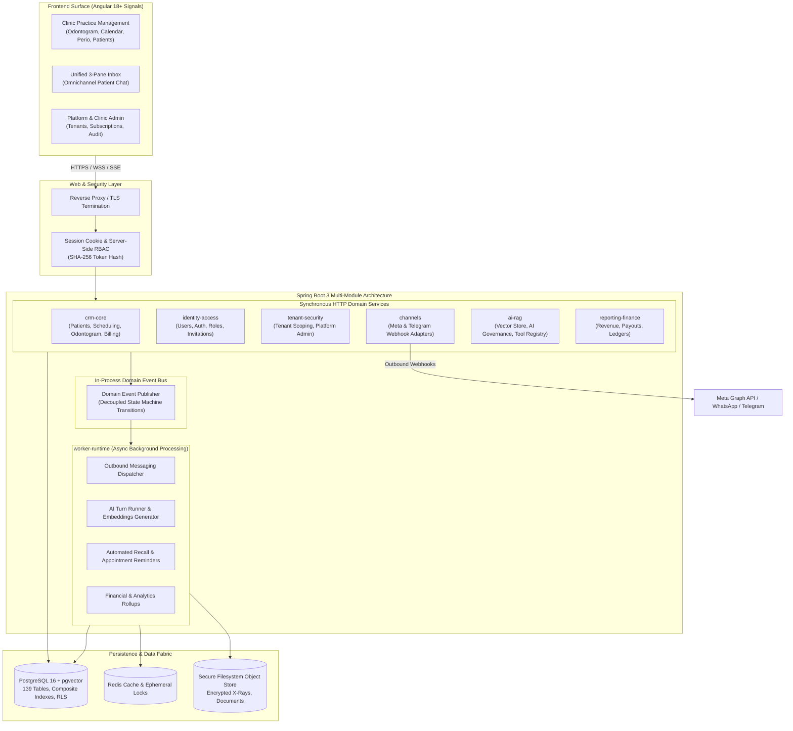
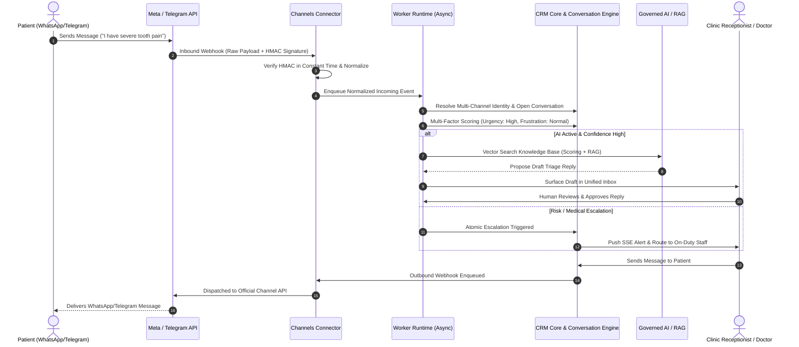

# FirstElement Dental Clinic / ClinicFlow
## Comprehensive System Architecture, Domain Specifications & Enterprise Strengths

> **Document Version:** 1.0.0 (Production Master Reference)  
> **Target Market:** Dental Healthcare Providers & Polyclinics (Jordan & MENA Region)  
> **System Primary Domain:** Specialized Dental Electronic Health Records (EHR), Clinical Practice Management, Omnichannel Patient CRM, and Governed Clinical AI Assistant.  
> **Default Locale & Currency:** Arabic-First (Native RTL) with English (LTR) & Jordanian Dinar (**JOD with 3 decimal places / fils**).

---

## 1. Executive Summary & Vision

**FirstElement Dental Clinic (ClinicFlow)** is an enterprise-grade, multi-tenant dental clinic management and patient engagement platform. It bridges the critical industry gap between:
1. **Rigid Legacy Dental EHRs:** Software that possesses dental charting but lacks modern omnichannel communication, patient engagement, and cloud agility.
2. **Generic Business CRMs:** Systems that have basic messaging and customer records but zero clinical safety, no dental odontograms, no periodontal charting, and no healthcare data isolation.

ClinicFlow is built as a **dual-engine platform**: a deeply specialized Dental Clinical Information System (patients, FDI odontograms, 6-site periodontal charting, treatment plans, encounters, prescriptions, lab tracking, appointments, and 3-decimal billing) tightly integrated with an **Omnichannel Messaging & Governed AI Engine** (WhatsApp Cloud API, Instagram, Messenger, Telegram, automated escalation, and human-in-the-loop AI assistance).

The platform was engineered as an enterprise strangler migration from a legacy TypeScript stack to a **high-performance Spring Boot 3 multi-module backend** backed by **PostgreSQL (with pgvector)** and a modern **Angular 18+ Standalone frontend** using Angular Signals and a bespoke Arabic-first design system.

```
+---------------------------------------------------------------------------------------+
|                               FIRSTELEMENT CLINICFLOW                                 |
+-------------------------------------------+-------------------------------------------+
|          CLINICAL DENTAL ENGINE           |         OMNICHANNEL CRM & AI ENGINE       |
|  - Patient Demographics & Consents        |  - WhatsApp, Instagram, Telegram, FB      |
|  - FDI 11-85 Odontogram & Restorations   |  - Unified 3-Pane Messaging Inbox         |
|  - 6-Site Periodontal Charting & CAL      |  - Multi-Channel Identity Resolution      |
|  - Encounters, SOAP Notes & Amendments    |  - Multi-Factor Conversation Scoring      |
|  - Multi-Option Treatment Plans           |  - Deterministic Routing & Handoff        |
|  - Digital Prescriptions & Drug Catalog   |  - Governed AI Assistant (Human-in-Loop)  |
|  - Dental Lab Orders & Tracking           |  - Emergency AI Kill-Switch (CLN-09)      |
|  - JOD 3-Decimal Ledger & Billing         |  - RAG Vector Knowledge Base (pgvector)   |
|  - Database-Constrained Room/Dr Schedule  |  - Real-Time Push Notifications (SSE)     |
+-------------------------------------------+-------------------------------------------+
|         ENTERPRISE CORE: Spring Boot 3 Multi-Module, PostgreSQL 16 (pgvector),        |
|          Hand-Crafted JDBC, AES-256-GCM, Break-Glass Protocol, Multi-Tenant B-Tree    |
+---------------------------------------------------------------------------------------+
```

---

## 2. System Architecture & High-Level Topology

The system is partitioned into cleanly bounded services sharing a strictly isolated multi-tenant database. Heavy background work is isolated from synchronous user-facing HTTP transactions.



### 2.1 Backend Modular Layout (16 Modules)
The backend is structured under `backend/` with Gradle multi-project isolation:

1. `app-bootstrap`: Application main entry point, health actuators, graceful shutdown, environment baseline.
2. `crm-core`: The core clinical and CRM domain (patients, appointments, schedules, encounters, odontograms, periodontal records, treatment plans, billing, media attachments, cancellation policies, and staff).
3. `identity-access`: Authentication, session lifecycle (opaque HTTP-only cookies, SHA-256 hashing, session revocation, IP/UserAgent auditing), permission inspection, user provisioning, password resets, and staff invites.
4. `tenant-security`: Multi-tenancy enforcement, organization and clinic project scope filters, support access control, and cross-tenant leak prevention.
5. `channels`: Inbound and outbound connectors for WhatsApp Cloud API, Instagram Messaging, Facebook Messenger, Telegram Bot API, and a local mock channel for tests.
6. `ai-rag`: RAG knowledge base management, document chunking and vector indexing (pgvector), deterministic AI run execution, token accounting, and tool registries.
7. `inbox-helpdesk`: 3-pane unified inbox, saved queue filters, conversation thread management, customer 360 sidebar, notes, tags, cases, and assignments.
8. `workflows-sla-routing`: Automated sentiment/urgency/frustration scoring, atomic AI-to-human escalation, skill- and workload-based deterministic routing engine, SLA monitors.
9. `notifications-realtime`: Server-Sent Events (SSE) streaming real-time notifications to the Angular client.
10. `reporting-finance`: Financial ledger metrics, receivables aging, procedure demand rollups, doctor commissions, and payouts.
11. `reporting-exports`: Asynchronous data exports (CSV, Excel) with strict role-based PHI redaction and directory-traversal-guarded file storage.
12. `operations-observability`: Health dashboards, queue depth metrics, database connection pool telemetry, and audit event logs.
13. `administration`: Platform administrative tools, organization setup, subscription plans, quota limits, and database maintenance.
14. `shared-kernel`: Shared domain value objects, money representations (3 decimals), pagination cursors, and standardized error envelopes.
15. `database`: Flyway database migrations (47 migrations, 139 tables, multi-column indexes), seed data fixtures, and database-level constraint scripts.
16. `worker-runtime`: Long-running async workers, reminder dispatchers, scheduled tasks, and retryable jobs.

---

## 3. Deep Dive: Clinical Dental Features (Slices S1 – S9)

ClinicFlow delivers a complete clinical suite modeled on the operational realities of modern dental practices:

### 3.1 S1: Patient Records, Family Hierarchy & Legal Consents
- **Patient 360 Profile:** Complete patient demographics, national ID / civil number, emergency contacts, blood type, and referral tracking.
- **Family & Guarantor Relationships (`patient_relationships`):** Supports complex family structures (Parent, Guardian, Guarantor, Child, Spouse). Billing can be redirected to the legal guarantor.
- **Duplicate Detection & Reversible Merge:** Algorithmic duplicate matching based on normalized phone, national ID, and name. Merging patient records is fully audited and can be safely reversed.
- **Consent Ledger (`patient_consents`):** Digital capture of General Treatment Consent, Surgical/Anesthetic Consent, and Data Privacy disclosures. All consent modifications are append-only.
- **Legal Retention Compliance (DEC-007):** Automatic enforcement of the 10-year retention floor from the last clinical procedure for medical records in Jordan.

### 3.2 S2: Resources, Calendering & Overlap Protection
- **Multi-Chair & Room Management:** Models operatories (chairs), surgical rooms, and radiography equipment alongside doctor working shifts.
- **Database-Level Exclusion Constraints:** Implements PostgreSQL exclusion constraints (`btree_gist`) to guarantee that neither a doctor nor a chair can ever be double-booked across overlapping time intervals, completely preventing concurrency race conditions.
- **Appointment Lifecycle & Status Machine:** `SCHEDULED` $\rightarrow$ `CONFIRMED` $\rightarrow$ `CHECKED_IN` $\rightarrow$ `IN_PROGRESS` $\rightarrow$ `COMPLETED` $\rightarrow$ `CANCELLED` $\rightarrow$ `NO_SHOW`.
- **Appointment Holds & ASAP Waitlist:** Temporary booking holds with automated TTL expiration, and an intelligent waitlist queue for prioritizing short-notice cancellations.
- **Automated Messaging Reminders:** Integrated with WhatsApp and Telegram to send automated appointment confirmations and reminder notifications.

### 3.3 S3: Clinical Encounters, SOAP Notes & Medical History
- **Structured Medical History:** Granular tracking of systemic medical conditions (cardiovascular, diabetes, hypertension), bleeding disorders, and drug allergies (Penicillin, Latex, NSAIDs) with prominent warning banners on all clinical views.
- **SOAP Clinical Encounters:** Subjective, Objective, Assessment, and Plan notes captured during patient visits.
- **Cryptographic/Digital Signing & Immutability:** Once an encounter is marked `SIGNED`, the record is locked permanently.
- **Append-Only Clinical Amendments (`encounter_amendments`):** Any subsequent clinical note or correction must be added as an amendment with the author’s identity, exact timestamp, and clinical justification.

### 3.4 S4: Interactive FDI Odontogram & Periodontal Charting
- **FDI Two-Digit Notation (11–48 Permanent, 51–85 Primary):** Full support for international dental tooth numbering across adult and pediatric dentitions.
- **5 Anatomical Surfaces per Tooth:** Mesial (M), Occlusal/Incisal (O/I), Distal (D), Buccal (B), and Lingual (L).
- **Comprehensive Finding Vocabulary:** Charting of Caries, Existing Amalgam, Composite Restorations, Ceramic Crowns, Root Canal Treatments (RCT), Implants, Missing Teeth, Impacted Teeth, and Veneers.
- **6-Site Periodontal Charting:** Measures probing depth (PD) at 6 distinct sites per tooth (Distobuccal, Midbuccal, Mesiobuccal, Distolingual, Midlingual, Mesiolingual).
- **Periodontal Indicators:** Bleeding on Probing (BOP), Plaque Index, Gingival Margin, Furcation Involvement (Grades I–III), Mobility (Classes I–III), and automatically derived Clinical Attachment Loss (CAL).
- **Multi-State Visualization:** Instant toggling between **Current Status**, **Proposed Treatment Plan**, and **Completed Procedures**.

### 3.5 S5: Multi-Option Treatment Plans & Procedure Catalog
- **Procedure Catalog:** Configurable procedures with category codes, default duration, mandatory teeth/surfaces requirements, post-procedure recovery buffer minutes, and default prices in JOD fils.
- **Comparative Treatment Options (Option A vs. Option B):** Allows presenting conservative vs. comprehensive rehabilitation plans (e.g., Crown vs. Extraction & Implant) with separate cost estimates.
- **Staged Phasing:** Grouping procedures into treatment phases (Phase 1: Urgent/Periodontal, Phase 2: Restorative, Phase 3: Prosthodontic/Orthodontic).
- **Patient Approval & Version Snapshotting:** When a patient signs off on a treatment plan, an immutable versioned snapshot is created to guarantee that billing and planned procedures cannot be tampered with retrospectively.

### 3.6 S6: Financial Ledger, 3-Decimal Invoicing & Payments
- **High-Precision Money (`NUMERIC(15, 3)`):** Built specifically for Jordan's currency system (1 JOD = 1,000 fils). Prevents rounding discrepancies common in software assuming 2 decimal places.
- **Multi-Item Clinical Invoices:** Automatically generated from accepted treatment plan procedures or ad-hoc services, supporting multi-line discounts and tax rates.
- **Dual-Entry Patient Ledger:** Tracks receivables, unallocated credit, payments, and refunds in an append-only accounting ledger.
- **Payment Methods & Reversals:** Supports Cash, Credit Card, Bank Transfer, Insurance, and Clinic Credit. Includes idempotent payment processing and audited payment reversal transactions with reason tracking.

### 3.7 S7: Clinical Media, X-Rays & Document Storage
- **Dental Imaging Gallery:** Direct storage and viewing of Bitewing, Periapical, Panoramic (OPG), and CBCT radiographs, as well as intraoral photography and dental lab scans.
- **Strict Media Security:**
  - MIME-type allowlisting (JPEG, PNG, DICOM, PDF).
  - SHA-256 integrity hash verification upon ingestion.
  - Storage paths protected against path traversal attacks (`../`).
  - Access controlled via short-lived signed URLs.
- **Legal Hold:** Ability to mark records and attachments under legal hold, disabling deletion regardless of standard retention schedules.

### 3.8 S8: Audit Logging, Break-Glass Security & Reports
- **Comprehensive PHI Read/Write Audit (`clinic_audit_log`):** Records every single access to patient clinical records, including who viewed the record, the exact timestamp, the IP address, and the action taken.
- **Break-Glass Emergency Protocol:** If an unassigned clinician or emergency doctor needs to access a restricted patient record, the system requires a mandatory "Break-Glass" prompt specifying the emergency clinical justification. This immediately grants a temporary time-bounded session while triggering real-time administrative audit alerts.
- **Curated Practice Reports:**
  - Daily/Monthly Revenue & Collections.
  - Doctor Productivity & Commission Calculations.
  - Procedure Demand & Utilization Analytics.
  - Appointment Attendance, Cancellation & No-Show Rates.

### 3.9 S9: Governed Clinical AI Assistant (Human-in-the-Loop)
- **Compliance with CLN-09 Guidelines:** Autonomous clinical diagnosis, autonomous prescription generation, and automated patient chart mutations are strictly prohibited. The AI acts exclusively as an assistive drafting tool.
- **Emergency Hardware Kill-Switch (`clinic_ai_governance`):** Clinic administrators can engage a global or clinic-level AI Kill-Switch with a single click, instantly severing all AI background jobs and draft generation across the tenant.
- **Governed Proposal Workflow (`clinic_ai_proposals`):** All AI outputs are saved in a `DRAFT` state and must be explicitly reviewed, accepted, or rejected by an authorized human clinician or staff member before affecting any patient records.
- **Domain AI Capabilities:**
  - *Visit Summary Drafter:* Synthesizes doctor's shorthand notes into formatted SOAP summaries.
  - *Recall Prioritization Engine:* Identifies patients overdue for hygiene or periodontal recalls based on clinical risk factors.
  - *Missing Fields Audit:* Detects missing contact info, outdated emergency contacts, or absent medical history updates.
  - *Payment Matching:* Proposes FIFO allocations of unapplied patient payments to open invoices.

---

## 4. Deep Dive: Omnichannel CRM & Messaging Engine

ClinicFlow incorporates a multi-channel communication infrastructure that connects patients directly to the clinic's reception desk:



### 4.1 Channels & Webhook Security
- **Supported Channels:** WhatsApp Cloud API, Instagram Messaging, Facebook Messenger, and Telegram Bot API.
- **Constant-Time Verification:** Inbound Meta requests verify `X-Hub-Signature-256` against the raw byte payload using constant-time comparison algorithms to prevent timing attacks. Telegram uses secret token validation.
- **Write-Only Credential Vault:** Channel access tokens and app secrets are encrypted at rest using **AES-256-GCM** and are strictly write-only—no REST endpoint ever returns credentials in plain text.
- **Normalized Canonical Contract:** Incoming vendor payloads are translated into a normalized internal message structure before any CRM service processes them.

### 4.2 Multi-Channel Identity Resolution
- Automatically links phone numbers, WhatsApp IDs, and Telegram usernames to a unified `Customer` record, which is mapped to the corresponding `Patient` in the clinic domain.

### 4.3 Conversation Scoring & Atomic Handoff
- Every customer turn is scored across 4 vectors: **Urgency**, **Frustration**, **Sentiment**, and **Risk**.
- An automated escalation engine monitors score trends against customizable thresholds.
- **Atomic Handoff:** Transitions between AI handling and human agent ownership are governed by database-level atomic states, eliminating race conditions between automated replies and human intervention.

### 4.4 Deterministic Staff Routing
- Escalations are routed through a multi-stage deterministic pipeline:
  1. *Project/Clinic Membership Check.*
  2. *Department and Skill Matching (e.g., Arabic-fluent front desk, orthodontics).*
  3. *Working Hours & Timezone Validation.*
  4. *Current Workload & Capacity Headroom.*
- Assigns the least-loaded eligible staff member. If no agent is available, the system logs the exact blocking constraint rather than dropping the message silently.

---

## 5. Technology Stack & Technical Foundation

| Layer | Technology | Key Capabilities & Rationale |
|---|---|---|
| **Backend Framework** | **Java 21 / Spring Boot 3.x** | Enterprise stability, multi-module encapsulation, virtual threads, high throughput. |
| **Security & Auth** | **Spring Security 6** | Cookie-based session tokens, SHA-256 hashing, fine-grained RBAC matrix, IP auditing. |
| **Persistence & Data** | **Hand-Crafted JDBC SQL** | Absolute query performance control, zero ORM N+1 overhead, explicit multi-tenant predicates. |
| **Database Engine** | **PostgreSQL 16 + pgvector** | Robust relational model, `btree_gist` exclusion constraints, vector embeddings storage. |
| **Migration Tool** | **Flyway** | 47 immutable migrations, strictly validated baseline acceptance tests. |
| **Job & Task Runner** | **worker-runtime + Redis** | Background asynchronous processing, delayed jobs, rate-limited outbound dispatch. |
| **Frontend Framework** | **Angular 18+ (Standalone)** | Signal-based reactive state, no `NgModule` baggage, lazy loaded routes, high performance. |
| **Styling & Design System** | **Tailwind CSS + Custom Tokens** | Arabic-first RTL support, responsive layouts, medical color palettes, keyboard accessibility. |
| **Realtime Engine** | **Server-Sent Events (SSE)** | Lightweight, reliable server-to-client event streaming without WebSocket connection complexity. |
| **Cryptographic Standards** | **AES-256-GCM & SHA-256** | Zero plaintext secrets, secure media checksums, constant-time webhook validations. |

---

## 6. Multi-Tenancy, Database Architecture & Indexing Strategy

ClinicFlow enforces a strict hierarchical multi-tenant architecture:

$$\text{Organization} \longrightarrow \text{Project (Clinic Branch)} \longrightarrow \text{Domain Data (Patients, Appointments, Encounters, Ledgers)}$$

```
+-------------------------------------------------------------------------------+
|                       DATABASE ISOLATION & COMPOSITE KEYS                     |
+-------------------------------------------------------------------------------+
| Every tenant table contains:                                                  |
|   - organizationId (UUID NOT NULL)                                            |
|   - projectId      (UUID NOT NULL)                                            |
|                                                                               |
| Strict ADR V4 Indexing Rule:                                                  |
|   - ZERO raw global unique constraints (pg_constraint.contype = 'u' is 0)    |
|   - All uniqueness is enforced via Composite Unique Indexes:                  |
|     UNIQUE ("organizationId", "projectId", "code" / "email" / "id")           |
|   - Prevents cross-tenant key collision while allowing duplicate codes        |
|     across different independent clinics.                                     |
+-------------------------------------------------------------------------------+
```

### Database Key Metrics
- **47 Flyway Migrations** managed across both deployment and development environments.
- **139 Public Tables** modeling the comprehensive healthcare and CRM domain.
- **351 Foreign Keys** guaranteeing referential integrity.
- **534 Check Constraints** ensuring data validity at the database engine level (e.g., status enums, non-negative amounts, date ranges).
- **311 Tenant-Led Composite B-Tree Indexes** optimizing query execution paths and enforcing tenant-scoped uniqueness.

---

## 7. Frontend User Experience & Arabic-First Design System

The frontend in `frontend/src/app` is crafted with an **Arabic-First (RTL)** philosophy, treating English as a first-class toggleable secondary locale.

### Key Frontend Capabilities
1. **Interactive SVG Dental Odontogram (`clinic-odontogram.component.ts`):** Custom SVG rendering for all 32 permanent and 20 primary teeth. Allows multi-surface selection, tooth-level notes, and visual restoration coloring.
2. **Periodontal Grid (`clinic-odontogram.component.ts`):** 6-point probing depth interactive entry matrix with immediate visual flagging of deep pockets ($\ge 4\text{ mm}$) and active Bleeding on Probing (BOP).
3. **Multi-View Calendar (`clinic-calendar.component.ts`):** Views by Day, Week, Month, Operatory (Chair), and Doctor. Drag-and-drop rescheduling with instant conflict alerts.
4. **Encounter & SOAP Clinical Dashboard (`clinic-encounters.component.ts`):** Streamlined clinician workspace for documenting findings, reviewing medical warnings, prescribing medications, and locking encounters with digital signatures.
5. **Unified 3-Pane Inbox (`inbox.component.ts`):**
   - Left Pane: Filtered queues (Mine, Unassigned, Escalated, Bot Active, Completed).
   - Center Pane: Real-time conversation thread with message status markers (sent, delivered, read) and AI suggestion badges.
   - Right Pane: Comprehensive Patient 360 card (medical alerts, next appointment, outstanding balance, open treatment plans).
6. **Platform Administration Console (`platform-dashboard.component.ts`):** Global multi-clinic overview, subscription tiers, plan limits enforcement, system audit logs, and support access delegation.

---

## 8. Summary of Distinct Strong Points & Competitive Moats

### 1. True Dual-Core Architecture (Dental EHR + Omnichannel CRM)
Generic dental systems have no modern chat capabilities; generic CRMs lack medical safety and dental charting. ClinicFlow brings both together in a single unified platform. A patient can chat on WhatsApp to book an appointment, and the clinic receptionist can see their dental history, treatment plan, and balance in the same workspace.

### 2. Native Arabic-First (RTL) Architecture
Built from the ground up with native RTL layouts, correct typographical hierarchy, and localized Arabic dental terminology, avoiding the awkward alignment and layout issues common in retrofitted Western EHRs.

### 3. Database-Guaranteed Scheduling Integrity
Double-booking is prevented not merely by application-level validation, but by **PostgreSQL exclusion constraints (`btree_gist`)**. Even under heavy concurrent booking attempts across web, mobile, and WhatsApp, the database guarantees that neither a doctor nor a chair can be double-booked.

### 4. High-Precision Financial Accounting (3-Decimal JOD)
Designed natively for Jordan and the MENA region with `NUMERIC(15, 3)` currency storage, completely eliminating rounding errors and accounting discrepancies in fils.

### 5. Ethical, Governed Healthcare AI with Hardware Kill-Switch
Full compliance with medical AI safety guidelines (CLN-09). The AI never makes autonomous diagnosis or unreviewed patient modifications. Every proposal requires human-in-the-loop signoff, and clinic administrators have an immediate kill-switch to halt AI operations instantly if necessary.

### 6. Medical Immutability & Legal Protection (DEC-007)
Encounters and clinical notes are immutable once signed. All subsequent edits are append-only amendments. The system enforces Jordan's statutory 10-year retention floor from the last completed procedure.

### 7. Emergency Break-Glass Protocol
Provides emergency physicians with immediate access to restricted patient data when clinically necessary, while simultaneously enforcing mandatory reason capture and logging real-time audit alarms.

### 8. Enterprise Performance: Hand-Crafted JDBC over Heavy ORMs
By utilizing hand-crafted, parameterized JDBC SQL rather than bulky ORMs like Hibernate/JPA, ClinicFlow achieves predictable sub-millisecond query execution, zero N+1 query surprises, and complete visibility over database execution plans.

### 9. Ironclad Webhook & Channel Security
Constant-time HMAC cryptographic verification, AES-256-GCM write-only secret vaults, and sanitized canonical data normalization ensure that external messaging webhooks cannot compromise the clinic's internal infrastructure.

---

## 9. Conclusion

FirstElement Dental Clinic (ClinicFlow) represents a modern, clinically rigorous, and technically robust platform. It bridges patient communication, clinical charting, and financial management into a unified, secure, Arabic-first ecosystem ready for enterprise healthcare deployment.
